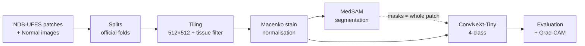
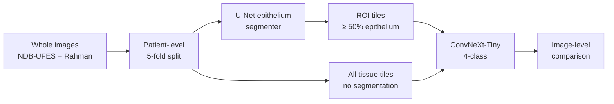
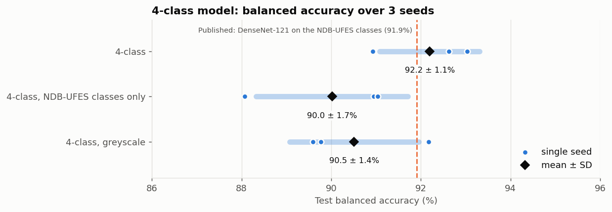
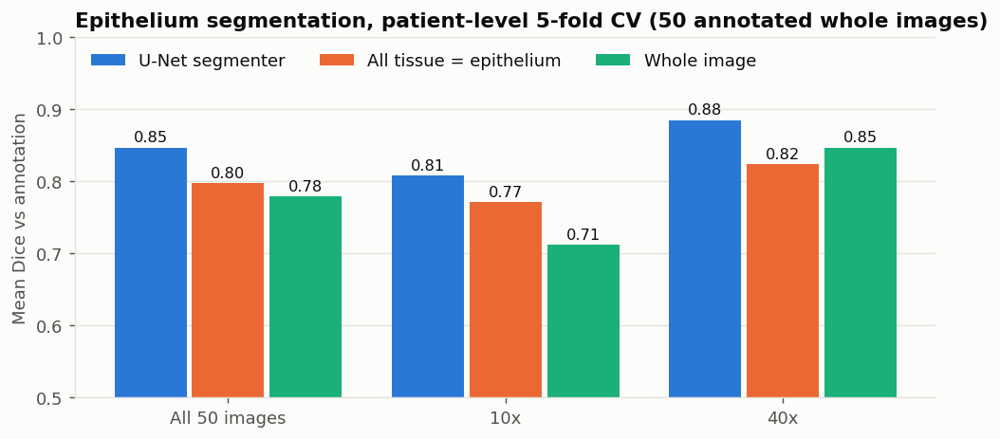
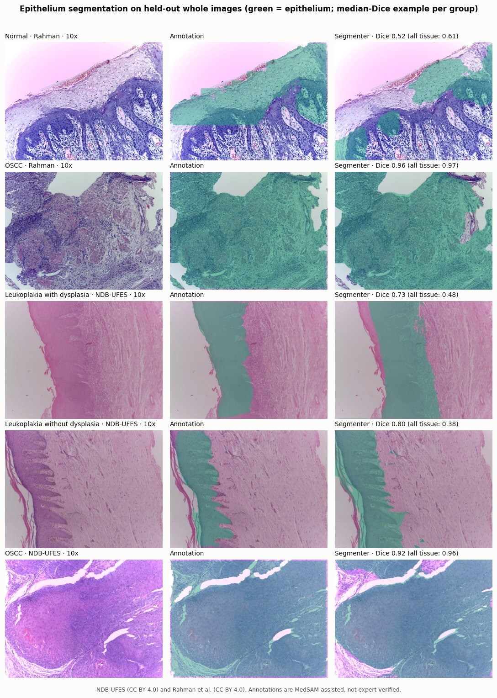
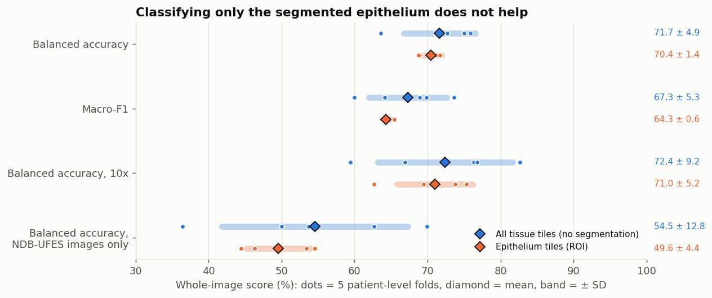
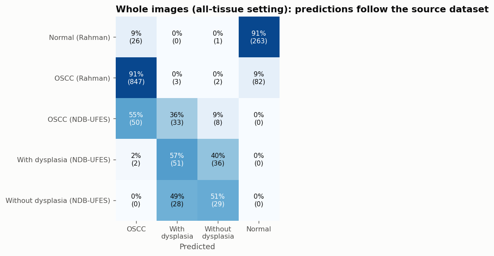
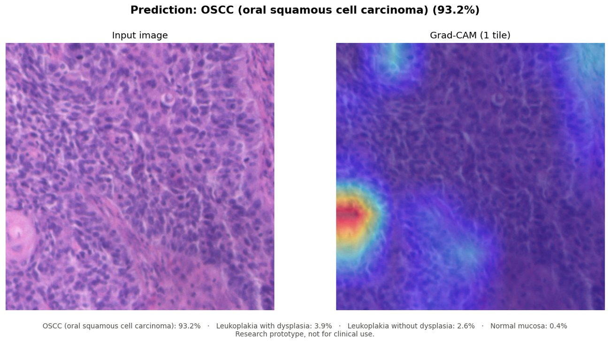

# Oral Carcinoma Histopathology: Segmentation & Classification


Deep-learning pipeline for **four-class classification of oral histopathology images**: oral squamous cell carcinoma (OSCC), leukoplakia with dysplasia, leukoplakia without dysplasia, and normal mucosa. It also investigates whether **segmentation before classification** helps, first with MedSAM on patches, then with a trained epithelium segmenter on whole microscope images (segmentation → ROI → classification).

> **Research question:** does localising the relevant tissue before classifying it with ConvNeXt-Tiny give the classifier a better input than the whole image?

---

## Key results

| | Result |
|---|---|
| **4-class ConvNeXt-Tiny** (test, n = 1,049) | **92.2 ± 1.1% balanced accuracy · 92.0 ± 0.8% macro-F1 · 0.985 macro AUC** |
| Same model, NDB-UFES classes only (OSCC, with / without dysplasia) | 90.0 ± 1.7% balanced accuracy (published DenseNet-121 benchmark on the same folds: 91.9%) |
| **MedSAM segmentation** (all 6,626 patches) | Masks cover a median **95–98%** of each patch, so the ROI is the whole patch |
| **Shortcut analysis** | The Normal class is separable by image-level properties of its source dataset (sharpness, brightness, contrast). Sharpness was removed by calibrated blur; Grad-CAM still shows border-focused, image-level evidence for Normal |
| **Epithelium segmenter** (U-Net, 50 annotated whole images, patient-level CV) | **Dice 0.85** vs 0.80 for "all tissue" and 0.78 for the whole image; 0.81 vs 0.77 / 0.71 on 10× images |
| **Segmentation → ROI → classification** (1,461 whole images, patient-level CV) | **70.4 ± 1.4%** image-level balanced accuracy with epithelium tiles vs **71.7 ± 4.9%** with all tissue tiles: **no gain** from the ROI |

Patch results are **mean ± SD over 3 random seeds** on the official NDB-UFES test fold; whole-image results are mean ± SD over 5 patient-level folds. See [Limitations](#limitations).

---

## Contents

1. [Pipeline](#pipeline)
2. [Datasets](#datasets)
3. [Preprocessing](#preprocessing)
4. [Segmentation (MedSAM)](#segmentation-medsam)
5. [Classification (ConvNeXt-Tiny)](#classification-convnext-tiny)
6. [Explainability (Grad-CAM)](#explainability-grad-cam)
7. [Whole images: segmentation → ROI → classification](#whole-images-segmentation--roi--classification)
8. [Limitations](#limitations)
9. [Project structure](#project-structure)
10. [Getting started](#getting-started)
11. [Prediction tool](#prediction-tool)
12. [Project status](#project-status)
13. [References](#references)

---

## Pipeline



MedSAM was implemented and run on the full dataset. Its masks covered almost the entire patch, so the classifier is trained on **whole patches**; see [Segmentation](#segmentation-medsam).

A second pipeline works on the **whole microscope images**, where there is something to segment (epithelium vs connective tissue and glass):



---

## Datasets

| Dataset | Used for | Images | Licence |
|---|---|---|---|
| **NDB-UFES** (de Assis et al., 2023) | OSCC, leukoplakia with / without dysplasia | 3,763 patches (512×512) from 237 images, 69 patients | CC BY 4.0 |
| **Histopathological imaging database for oral cancer** (Rahman et al., 2020) | Normal (patch pipeline); Normal + OSCC (whole-image pipeline) | 290 Normal images (2048×1536; 89 at 100×, 201 at 400×) → 2,863 tiles; 934 OSCC images (439 at 100×, 495 at 400×) | CC BY 4.0 |

The whole-image pipeline uses the 237 NDB-UFES source images (2048×1536: 91 OSCC, 89 with dysplasia, 57 without dysplasia) together with all 1,224 Rahman images: **1,461 images** in total.

Both datasets were captured with a Leica ICC50 HD camera at 2048×1536 using 10× / 40× objectives. They are stored locally and are not part of this repository.


### Splits

| Split | NDB-UFES | Normal (source images → tiles) | Total |
|---|---|---|---|
| Train | 2,509 (folds 1–4) | 202 → 2,001 | 4,510 |
| Validation | 627 (fold 5) | 44 → 440 | 1,067 |
| Test | 627 (fold 6, official test set) | 44 → 422 | 1,049 |

- **NDB-UFES** keeps the dataset's official folds, so results are comparable with published work.
- **Normal** images are split at the image level *before* tiling, so all tiles of one image stay in the same split.

---

## Preprocessing


1. **Tiling instead of resizing.** NDB-UFES patches are native-resolution 512×512 crops. Resizing the 2048×1536 Normal images to 512 would shrink cells about 4× and give the classifier a scale shortcut, so they are cut into 512×512 tiles instead.
2. **Tissue filter.** Tiles with less than 60% tissue are discarded, matching the curation of NDB-UFES. Tissue is detected by optical density relative to each image's own background colour, which is robust to the strong colour casts in the Normal images.
3. **Sharpness matching.** NDB-UFES patches are much softer than the Normal images. Normal tiles get a Gaussian blur (σ = 2.5 px at 512 px), calibrated so that sharpness no longer separates the sources (see [Explainability](#explainability-grad-cam)).
4. **Macenko stain normalisation.** All images are mapped to one H&E appearance. The reference is fitted on 200 NDB-UFES **training** patches only.

**Colour-bias check.** A logistic regression that sees *only colour histograms* tries to identify the class:

| | 4-class balanced accuracy | Normal-vs-rest AUC |
|---|---|---|
| Before normalisation | 0.666 | 0.999 |
| After normalisation | 0.630 | 0.974 |

Normalisation removes the hue difference, but a colour/dataset signal remains. It is investigated further in [Explainability](#explainability-grad-cam).

---

## Segmentation (MedSAM)

MedSAM (ViT-B) was run on **all 6,626 patches**. Each patch received a **label-free** box prompt covering the stained tissue, so the same procedure applies at inference time.


*Columns: box prompt · MedSAM mask · ROI crop. One example per class (OSCC, with dysplasia, without dysplasia, Normal).*

**Finding.** The masks cover a median of 95–98% of each patch in every class. Almost all ROIs are the full 512×512 patch, and MedSAM's own predicted IoU is about 0.65 for every class.

**Why.** NDB-UFES patches are already cropped from *inside* the lesion, so there is no separate lesion region for a promptable segmenter to isolate. Classification therefore uses **whole patches**.

A meaningful segmentation target is the **epithelium**, where dysplasia is graded. On the whole microscope images it is a real region (next to connective tissue and glass), so it was annotated and segmented there; see [Whole images](#whole-images-segmentation--roi--classification).

---

## Classification (ConvNeXt-Tiny)

**Setup**
- **Model:** ConvNeXt-Tiny, ImageNet-pretrained, with a new 4-class head. Input is 224×224, resized from 512.
- **Augmentation:** flips, 90° rotations, random resized crops, strong colour jitter, and random Gaussian blur (added after the sharpness finding).
- **Training:** AdamW (lr 1e-4, weight decay 0.05), OneCycle schedule, mixed precision, batch size 32, up to 25 epochs.
- **Imbalance:** class-weighted cross-entropy with label smoothing 0.1.
- **Model selection:** best validation macro-F1, with early stopping (patience 6). The test set is evaluated **once** with the selected checkpoint.

### Results (test set)

All models are trained on the **sharpness-matched** data (see [Explainability](#explainability-grad-cam)). Each model was trained with **3 random seeds** (`notebooks/convnext_multiseed_kaggle.ipynb`); values are **mean ± SD**.

| Setting | Balanced acc. | Macro-F1 | Accuracy | Macro AUC | Normal F1 | NDB-UFES classes only (bal. acc.) |
|---|---|---|---|---|---|---|
| **4-class** | **92.2 ± 1.1%** | **92.0 ± 0.8%** | 93.8 ± 0.5% | 0.985 ± 0.001 | 99.3 ± 0.5% | 90.0 ± 1.7% |
| 4-class, greyscale | 90.5 ± 1.4% | 90.1 ± 1.6% | 92.0 ± 1.1% | 0.983 ± 0.001 | 98.0 ± 0.1% | 88.6 ± 1.9% |



**Comparison with published work.** Published results on this dataset cover only the three NDB-UFES classes (Normal is our addition from a second dataset). On those classes, the 4-class model reaches **90.0 ± 1.7%** balanced accuracy, against **91.9%** for DenseNet-121 in Maia et al. (2024) on the same official folds: comparable, about 2 points lower. These three classes all come from one source, so the cross-dataset shortcut described below does not affect this number.

**Reading the table**
- **Normal lifts the overall score.** The 4-class score (92.2%) is higher than the score on the NDB-UFES classes alone (90.0%) mainly because the cross-dataset Normal class is easy (~99% F1).
- **Greyscale input** costs about 1.7 points, within about one SD of the colour model. Colour helps a little but is not the main signal. Normal stays at ~98% F1 without colour.
- **Seed variation matters.** Single runs of the same model ranged over up to ~2 points (4-class: 90.9–93.0%), and an earlier single 4-class run of 88.6% was a low outlier against the 3-seed mean of 92.2%.


Per class (mean ± SD over the same 3 seeds), the colour model is ahead of greyscale in **every** class. "Without dysplasia" is the hardest class (85.9% F1) and varies most between runs.

The confusion matrix and training curves below come from one example run (seed 42). That run is the low outlier mentioned above (88.6%), so they show the *kind* of mistakes the model makes, not its average score.


Errors are almost entirely between **adjacent grades** (OSCC ↔ with dysplasia, with ↔ without dysplasia), and OSCC is never predicted as non-dysplastic. "Without dysplasia" is the hardest class, consistent with the literature.


---

## Explainability (Grad-CAM)


For the NDB-UFES classes, heatmaps highlight tissue regions such as cell-dense areas and atypical nuclei. For **Normal**, the strongest activation often lies at the patch edge, mostly the top edge. A border-focus check over **all** 1,049 test images quantifies this, both for the model trained before sharpness matching and for the current model:


- **NDB-UFES classes:** heatmaps are spread about as evenly as chance (46–54% of the heatmap on the border).
- **Normal, before sharpness matching:** about two thirds of the heatmap lies on the border, and the peak is on the border in 71–78% of images.
- **Normal, after sharpness matching:** still 59–61% on the border, and the peak is on the border in 71–79% of images.
- Tiles from the edge and from the interior of the source image behave the same, which **rules out** lighting or edge artefacts of the original microscope images. The top rows of Normal tiles are also no brighter than the rest (157 vs 154 mean intensity), so the edge focus is not a visible artefact in the pixels. It is how the network represents an image-level property.

**Sharpness test.** Each global image property is reduced to one number per image and used *alone* to separate Normal from the NDB-UFES classes (250 images per class, `scripts/analysis/check_sharpness.py`):

| Property (one number per image) | Normal-vs-rest AUC | Median, NDB-UFES classes | Median, Normal |
|---|---|---|---|
| **Sharpness at 224 px** (Laplacian variance, model input) | **0.946** | 54–80 | **333** |
| Contrast | 0.852 | 13–20 | 30 |
| Brightness | 0.832 | 133–143 | 162 |

Normal tiles are about 5× sharper. This global property explains both the border-focused Grad-CAM and Normal staying at ~99% F1 in greyscale: the earlier Normal result was largely a **dataset shortcut**.

**Mitigation.** A Gaussian blur on Normal tiles was calibrated by sweeping σ. σ = 2.5 px (512 px) was chosen. On the regenerated, sharpness-matched data, the sharpness AUC at the model's 224 px input dropped from 0.95 to **0.52**. Brightness and contrast cues remain (AUC 0.76 / 0.81); Normal tiles are clearly brighter (mean intensity ~155 vs ~141).

**Result after retraining.** Normal F1 stayed at 98.9% (98.3% in greyscale), and the Grad-CAM border focus for Normal only dropped from ~65% to ~60%. Removing sharpness did **not** force the model to use localised tissue features for Normal. It still separates Normal by image-level differences between the two source datasets, most likely brightness and contrast.

**Conclusion.**
- The high Normal score cannot be read as evidence that the model recognises normal tissue.
- Combining two datasets creates source-level cues that colour normalisation, tiling and sharpness matching do not fully remove.
- The 4-class result is reported with this documented limitation; its score on the three NDB-UFES classes (90.0 ± 1.7%) is unaffected by it.

---

## Whole images: segmentation → ROI → classification

Patches are already crops from inside the lesion, so segmentation had nothing to isolate. The **whole microscope images** are different: at 10× they show epithelium, connective tissue, muscle and empty glass. This experiment tests the full segmentation → ROI → classification pipeline on them.

### Data and splits
- **1,461 whole images:** the 237 NDB-UFES source images plus the 1,224 Rahman images (290 Normal, 934 OSCC).
- **Patient-level 5-fold cross-validation.** NDB-UFES images are grouped by patient (69 patients), so no patient is in both training and test. Rahman images have no patient IDs, so each image is its own group; folds are stratified by class and magnification. In round *k*, fold *k* is the test set and the next fold is the validation set.
- **Magnification is not a shortcut.** A nucleus-size estimator (`scripts/analysis/check_magnification.py`; 95% accurate on held-out images) finds about half of every class at 10× and half at 40×.

### Epithelium segmentation
- **Annotations.** 50 whole images (5 per source × class × magnification, 10 per fold) were annotated with MedSAM box prompts plus manual corrections. They are **AI-assisted and not verified by a pathologist**, so the scores below measure agreement with these masks.
- **Model.** U-Net with an ImageNet ResNet-34 encoder, trained at half resolution (1024×768) on random 512×512 crops with flips, rotations and colour jitter. Same patient-level folds; the best epoch is chosen on validation Dice.



| Method (test folds, 50 images) | Dice | IoU | Dice, 10× | Dice, 40× |
|---|---|---|---|---|
| **U-Net segmenter** | **0.847** | **0.763** | **0.808** | **0.885** |
| All tissue counts as epithelium | 0.798 | 0.699 | 0.771 | 0.824 |
| Whole image | 0.779 | 0.687 | 0.712 | 0.847 |

The segmenter beats both baselines, most clearly on 10× images. It is weakest on Rahman Normal images at 10× (Dice ~0.5), a group with only 5 annotated images.



### ROI vs all tissue
Every whole image was segmented by the model of the round that held out its fold, then cut into native 512×512 tiles (blur on all Rahman tiles, Macenko normalisation). Two tile sets were classified with the same ConvNeXt-Tiny setup:
- **all:** every tile with ≥ 60% tissue (no segmentation);
- **ROI:** every tile with ≥ 50% predicted epithelium.

Each whole image is scored by averaging the class probabilities of its tiles. Both settings cover exactly the same 1,461 images.



| Image-level, mean ± SD over 5 folds | All tissue tiles | Epithelium tiles (ROI) |
|---|---|---|
| Balanced accuracy | **71.7 ± 4.9%** | 70.4 ± 1.4% |
| Macro-F1 | **67.3 ± 5.3%** | 64.3 ± 0.6% |
| Balanced accuracy, 10× images | 72.4 ± 9.2% | 71.0 ± 5.2% |
| Balanced accuracy, NDB-UFES images only | 54.5 ± 12.8% | 49.6 ± 4.4% |

**Finding: the ROI does not help.** The two settings differ by less than their fold-to-fold spread and give the same answer for 92% of images; the ROI version is only more stable across folds. This also holds on 10× images, where segmentation removes the most non-epithelial tissue.

### Why: the source dataset dominates



- NDB-UFES images are **never** predicted Normal, and Rahman images are almost never predicted leukoplakia.
- Most OSCC images come from Rahman, so 45% of NDB-UFES OSCC images are called leukoplakia.
- Within one source the picture differs: Rahman Normal vs OSCC is about 91% correct, but NDB-UFES with vs without dysplasia is close to chance.

Removing stroma cannot remove a cue that is present in the epithelium tiles too. With patient-level folds, NDB-UFES whole-image accuracy (~50–55%) is far below the patch-level result (90.0%), whose folds share patients between training and test.

**Conclusion.** Segmentation → ROI → classification is implemented end to end and evaluated step by step: the segmenter learns the epithelium (Dice 0.85), but restricting the classifier to it does not improve whole-image classification on this mixed-source data.

---

## Limitations

- **Patch-level folds.** The official NDB-UFES folds were created by stratified K-fold over *patches*, not patients. Patches from the same patient can appear in training and test, so all NDB-UFES results, including published ones, are likely optimistic.
- **Cross-dataset Normal class.** Normal comes from a different institution. Sharpness, brightness and contrast differ between the sources. Even after sharpness matching, Grad-CAM shows Normal is recognised from image-level properties, so the Normal score (~99% F1) is not evidence of tissue-level recognition. A Normal class from the same institution as the other classes would be needed to remove this.
- **Few seeds.** Results are averaged over 3 seeds. Seed-to-seed spread is 1–2 points (SD), so differences smaller than that between settings are not meaningful.
- **Patch-level vs patient-level results.** On whole images with patient-level folds, accuracy on the NDB-UFES classes drops to about 50–55%, which shows how much the patch-level folds inflate results.
- **Mixed sources in the whole-image pipeline.** Normal and most OSCC images come from Rahman et al., the leukoplakia classes only from NDB-UFES. The classifier learns the source, so its 4-class whole-image score is not a measure of tissue recognition.
- **Epithelium annotations.** The 50 masks are MedSAM-assisted and not verified by a pathologist; Dice scores measure agreement with them. MedSAM on the patches has no reference masks at all.

---

## Project structure

```text
oral-cancer-detection/
├── README.md
├── CLAUDE.md                       # Guide for AI-assisted development
├── requirements.txt
│
├── oral_cancer/                    # Shared package (used by scripts, notebooks and the app)
│   ├── config.py                   # DATA_ROOT / OUTPUT_ROOT, relative CSV paths
│   ├── model.py                    # ConvNeXt-Tiny, transforms, Grad-CAM
│   ├── stain.py                    # Macenko stain normalisation
│   ├── tissue.py                   # Tiling + tissue detection
│   ├── segmenter.py                # U-Net epithelium segmenter (whole images)
│   ├── predictor.py                # Image → class probabilities + Grad-CAM
│   └── assets/macenko_reference.npz  # Stain reference (fitted on NDB-UFES train)
│
├── scripts/
│   ├── data/                       # Dataset construction & preprocessing
│   │   ├── check_dataset.py
│   │   ├── create_master_dataset.py
│   │   ├── create_splits.py
│   │   ├── preprocess.py           # Tiling + tissue filter
│   │   ├── stain_normalize.py      # Macenko normalisation
│   │   ├── make_kaggle_upload.py   # Zip data for a Kaggle Dataset
│   │   ├── create_whole_image_splits.py  # Patient-level folds for whole images
│   │   ├── tile_whole_images.py    # All-tissue and ROI tile sets per round
│   │   ├── make_annotation_upload.py
│   │   └── make_whole_image_upload.py
│   ├── analysis/                   # Data inspection & bias checks
│   │   ├── inspect_images.py
│   │   ├── inspect_samples.py
│   │   ├── visualize_dataset.py
│   │   ├── check_color_shortcut.py
│   │   ├── check_sharpness.py      # Single-property shortcut test + blur calibration
│   │   └── check_magnification.py  # 10x vs 40x from nucleus size
│   ├── segmentation/               # MedSAM (patches) and epithelium segmenter (whole images)
│   │   ├── auto_segment.py
│   │   ├── select_subset.py
│   │   ├── prepare_annotation_set.py
│   │   ├── select_epithelium_set.py   # 50 whole images to annotate
│   │   ├── precompute_embeddings.py   # MedSAM embeddings for annotation
│   │   ├── train_segmenter.py         # U-Net, patient-level CV
│   │   └── segment_whole_images.py    # Masks for all whole images
│   ├── classification/             # ConvNeXt-Tiny
│   │   ├── train_classifier.py
│   │   ├── summarize_seeds.py      # Mean ± SD over multi-seed runs
│   │   ├── summarize_roi.py        # Image-level ROI vs all-tissue comparison
│   │   └── gradcam.py
│   ├── inference/
│   │   └── predict.py              # Command-line prediction
│   └── reporting/
│       └── make_readme_figures.py  # Generates docs/images/
│
├── notebooks/                      # Kaggle GPU notebooks
│   ├── medsam_segmentation_kaggle.ipynb
│   ├── convnext_training_kaggle.ipynb
│   ├── convnext_multiseed_kaggle.ipynb   # multi-seed runs (3 seeds)
│   ├── medsam_embeddings_kaggle.ipynb    # embeddings for annotation
│   ├── segmenter_training_kaggle.ipynb   # epithelium segmenter only
│   └── roi_classification_kaggle.ipynb   # segmenter → ROI → classification
│
├── annotations/epithelium/         # annotation_set.csv, annotations.csv, masks/ (50 PNG masks)
│
└── docs/
    ├── guide_presentation.md       # Plain-language walkthrough for presenting the project
    └── images/                     # Figures used in this README

# Local only (git-ignored): dataset_1_ndb_ufes/, dataset_2_normal/, dataset_3_rahman_oscc/, splits/,
# preprocessed/, preprocessed_normalized/, segmentation/, runs/, outputs/
```

---

## Getting started

### Install

```bash
pip install -r requirements.txt
```

### Data layout

```text
dataset_1_ndb_ufes/
├── images/              # p0000.png ... (NDB-UFES patches)
├── whole_images/extracted/images/   # 0000.png ... (237 source images)
└── metadata/            # sabpatch_parsed_*.csv, ndb-ufes.csv
dataset_2_normal/
└── images/              # Normal_100x_*.jpg, Normal_400x_*.jpg
dataset_3_rahman_oscc/
└── images/              # OSCC_100x_*.jpg, OSCC_400x_*.jpg (whole-image pipeline only)
```

### Run the pipeline

All scripts are run **as modules from the project root**:

```bash
# 1. Data
python -m scripts.data.create_master_dataset
python -m scripts.data.create_splits
python -m scripts.data.preprocess
python -m scripts.data.stain_normalize

# 2. Bias check (optional)
python -m scripts.analysis.check_color_shortcut

# 3. Segmentation and classification: GPU recommended (see Kaggle below)
python -m scripts.segmentation.auto_segment
python -m scripts.classification.train_classifier --classes 4

# 4. Explainability and figures
python -m scripts.classification.gradcam
python -m scripts.classification.gradcam --border-check
python -m scripts.reporting.make_readme_figures
```

Whole-image pipeline (segmentation → ROI → classification):

```bash
python -m scripts.data.create_whole_image_splits         # patient-level folds
python -m scripts.data.make_whole_image_upload           # zip for Kaggle
# On Kaggle, notebooks/roi_classification_kaggle.ipynb runs:
#   train_segmenter → segment_whole_images → tile_whole_images → train_classifier (10 runs) → summarize_roi
python -m scripts.reporting.make_readme_figures --only epithelium_segmentation segmenter_dice roi_results roi_by_source
```

Paths default to the project folder. Override them with `ORAL_CANCER_DATA_ROOT` (inputs) and `ORAL_CANCER_OUTPUT_ROOT` (outputs). Paths inside CSV files are relative, so the CSVs work on any machine.

### Running on Kaggle (GPU)

1. `python -m scripts.data.make_kaggle_upload` creates `kaggle_upload/oral-cancer-data.zip` containing `splits/` and `preprocessed_normalized/`.
2. Upload it as a Kaggle Dataset. Private is recommended; both sources are CC BY 4.0, so credit them if you share it.
3. Import a notebook from `notebooks/`, add the dataset as input, and enable **GPU T4** and **Internet**.
4. Use **Save Version → Save & Run All**, then download the outputs (`segmentation.zip` / `runs.zip` / `roi_results.zip`).

---

## Prediction tool

A command-line tool predicts the class of a new H&E image and shows a Grad-CAM heatmap. It needs a trained model in `runs/<run>/best_model.pt` (download `runs.zip` from Kaggle); the stain reference ships with the code.

The image goes through the **same steps as the training data**:
1. **Tiling.** Images larger than one patch are cut into 512×512 tiles, never resized. Tiles with less than 60% tissue are skipped.
2. **Stain normalisation.** Each tile is Macenko-normalised with the training reference.
3. **Classification.** Each tile is classified at 224 px, and tile probabilities are averaged into one prediction.
4. **Heatmap.** Grad-CAM heatmaps from all tiles are stitched into one overlay.

On test patches, the tool reproduces the evaluation predictions exactly (probability differences ≤ 0.0003).

```bash
# Command line: prints probabilities, saves overlay + JSON to outputs/predictions/
python -m scripts.inference.predict path/to/image.png
```



> **Research prototype, not for clinical use.** It expects H&E images at 10×/40× objective, like the training data. Normal predictions are affected by the documented dataset shortcut; on Normal images the heatmap typically sits at each tile's top edge.

---

## Project status

| Phase | Status |
|---|---|
| Literature survey, dataset investigation, architecture | ✅ Done |
| Dataset construction, official splits, tiling, stain normalisation | ✅ Done |
| Colour-bias analysis | ✅ Done |
| MedSAM segmentation (full dataset) | ✅ Done (no localisation benefit on these patches) |
| ConvNeXt-Tiny 4-class + greyscale check | ✅ Done |
| Grad-CAM + border-focus check | ✅ Done |
| Identify the Normal shortcut (sharpness) and calibrate a blur fix | ✅ Done |
| Retrain on sharpness-matched data + Grad-CAM re-check | ✅ Done (Normal still image-level; documented) |
| Multi-seed runs (3 seeds, mean ± SD) | ✅ Done |
| Prediction tool (command line) | ✅ Done |
| Whole images: patient-level folds, magnification check, Rahman OSCC added | ✅ Done |
| Epithelium annotation (50 images, MedSAM-assisted) + U-Net segmenter | ✅ Done (Dice 0.85) |
| Segmentation → ROI → classification on whole images | ✅ Done (no gain over all tissue; source shortcut documented) |
| Final report / paper write-up | ⏳ Next |

---

## References

1. de Assis, M. C. F. R. et al. *NDB-UFES: An oral cancer and leukoplakia dataset composed of histopathological images and patient data.* Data in Brief 48, 109128 (2023). [Data](https://data.mendeley.com/datasets/bbmmm4wgr8/4)
2. Rahman, T. Y. et al. *Histopathological imaging database for oral cancer analysis.* Data in Brief 29, 105114 (2020). [Data](https://data.mendeley.com/datasets/ftmp4cvtmb/2)
3. Maia, B. M. S. et al. *Transformers, convolutional neural networks, and few-shot learning for classification of histopathological images of oral cancer.* Expert Systems with Applications 241, 122418 (2024).
4. Ma, J. et al. *Segment anything in medical images (MedSAM).* Nature Communications 15, 654 (2024).
5. Liu, Z. et al. *A ConvNet for the 2020s (ConvNeXt).* CVPR (2022).
6. Macenko, M. et al. *A method for normalizing histology slides for quantitative analysis.* ISBI (2009).
7. Selvaraju, R. R. et al. *Grad-CAM: Visual explanations from deep networks via gradient-based localization.* ICCV (2017).

---

## Team

- K. Siddhartha
- K. Yoganand
- D. Akhil
- D. Akash

**Guide:** Mrs. Bharathi D
