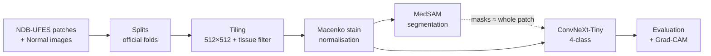
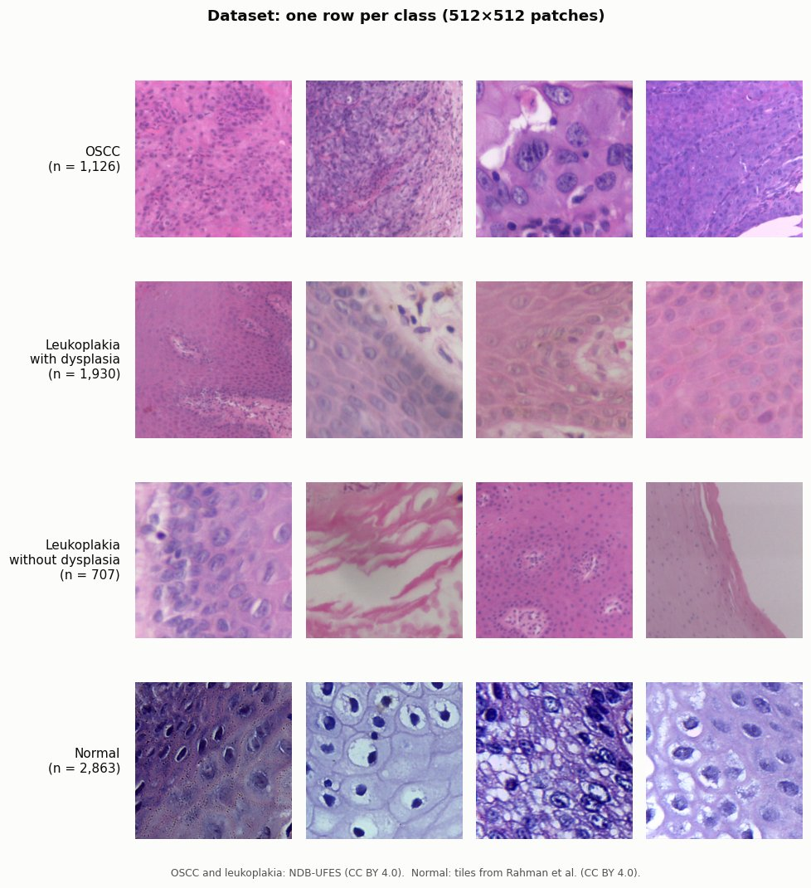
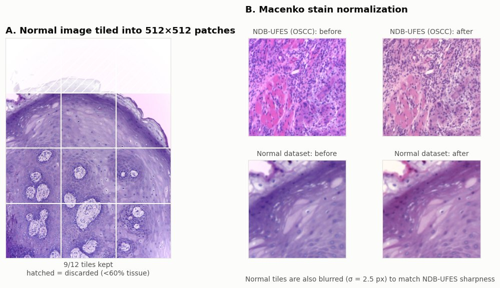
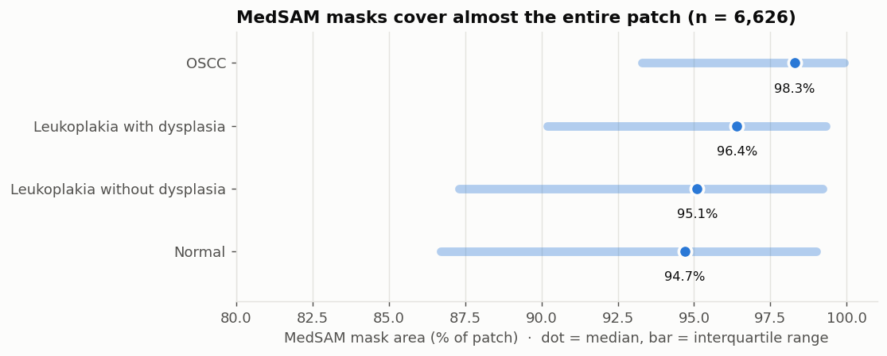
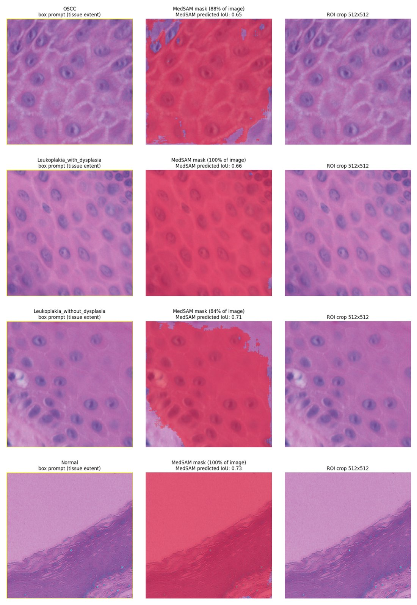
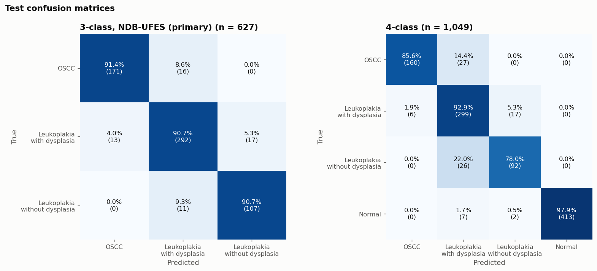
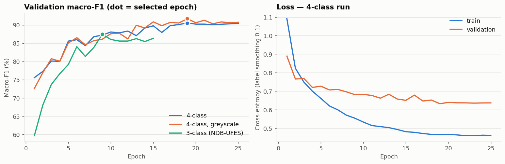
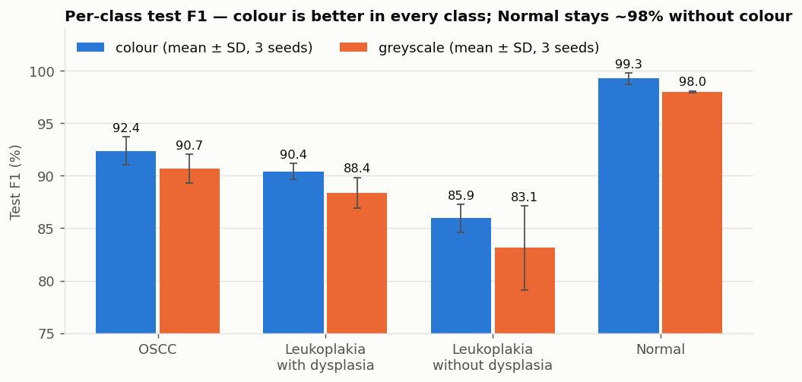
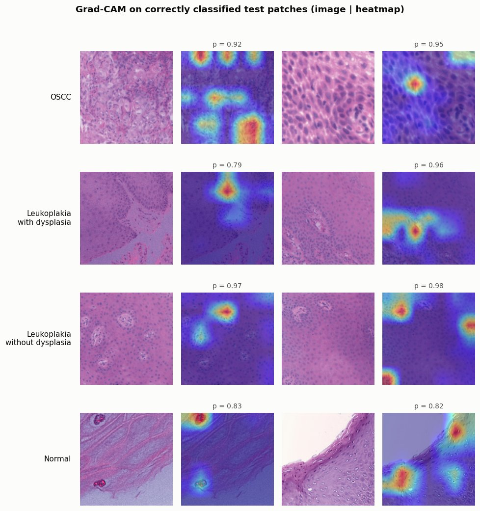
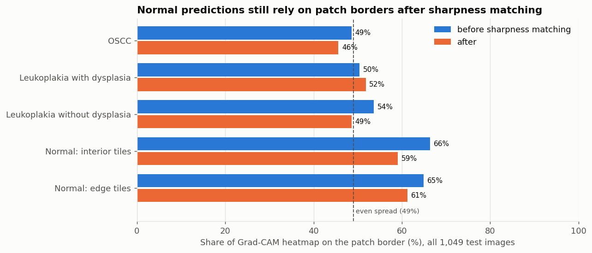

# Oral Carcinoma Histopathology: Segmentation & Classification


Deep-learning pipeline for **four-class classification of oral histopathology patches**: oral squamous cell carcinoma (OSCC), leukoplakia with dysplasia, leukoplakia without dysplasia, and normal mucosa. It also investigates whether **MedSAM lesion segmentation** before classification helps.

> **Research question:** does localising the lesion with MedSAM before classifying it with ConvNeXt-Tiny give the classifier a better input than the whole patch?

---

## Key results

| | Result |
|---|---|
| **4-class ConvNeXt-Tiny** (test, n = 1,049) | **92.8% balanced accuracy · 92.5% macro-F1 · 0.982 macro AUC** |
| NDB-UFES classes within the 4-class model | 91.1% balanced accuracy (published DenseNet-121 benchmark: 91.9%) |
| **MedSAM segmentation** (all 6,626 patches) | Masks cover a median **95–98%** of each patch, so the ROI is the whole patch |
| Explainability | Grad-CAM + a sharpness test show **Normal** is recognised largely from image sharpness (AUC 0.95 from one number), a dataset shortcut. It is now mitigated by sharpness matching; retraining is pending |

These are results from a single training run per setting. See [Limitations](#limitations).

---

## Contents

1. [Pipeline](#pipeline)
2. [Datasets](#datasets)
3. [Preprocessing](#preprocessing)
4. [Segmentation (MedSAM)](#segmentation-medsam)
5. [Classification (ConvNeXt-Tiny)](#classification-convnext-tiny)
6. [Explainability (Grad-CAM)](#explainability-grad-cam)
7. [Limitations](#limitations)
8. [Project structure](#project-structure)
9. [Getting started](#getting-started)
10. [Project status](#project-status)
11. [References](#references)

---

## Pipeline



MedSAM was implemented and run on the full dataset. Its masks covered almost the entire patch, so the classifier is trained on **whole patches**; see [Segmentation](#segmentation-medsam).

---

## Datasets

| Dataset | Used for | Images | Licence |
|---|---|---|---|
| **NDB-UFES** (de Assis et al., 2023) | OSCC, leukoplakia with / without dysplasia | 3,763 patches (512×512) from 237 images, 69 patients | CC BY 4.0 |
| **Histopathological imaging database for oral cancer** (Rahman et al., 2020) | Normal only | 290 images (2048×1536; 89 at 100×, 201 at 400×) → 2,863 tiles | CC BY 4.0 |

Both datasets were captured with a Leica ICC50 HD camera at 2048×1536 using 10× / 40× objectives. They are stored locally and are not part of this repository.



### Splits

| Split | NDB-UFES | Normal (source images → tiles) | Total |
|---|---|---|---|
| Train | 2,509 (folds 1–4) | 202 → 2,001 | 4,510 |
| Validation | 627 (fold 5) | 44 → 440 | 1,067 |
| Test | 627 (fold 6, official test set) | 44 → 422 | 1,049 |

- **NDB-UFES** keeps the dataset's official folds, so results are comparable with published work.
- **Normal** images are split at the image level *before* tiling, so all tiles of one image stay in the same split.

---

## Preprocessing



1. **Tiling instead of resizing.** NDB-UFES patches are native-resolution 512×512 crops. Resizing the 2048×1536 Normal images to 512 would shrink cells about 4× and give the classifier a scale shortcut, so they are cut into 512×512 tiles instead.
2. **Tissue filter.** Tiles with less than 60% tissue are discarded, matching the curation of NDB-UFES. Tissue is detected by optical density relative to each image's own background colour, which is robust to the strong colour casts in the Normal images.
3. **Sharpness matching.** NDB-UFES patches are much softer than the Normal images. Normal tiles get a Gaussian blur (σ = 2.5 px at 512 px), calibrated so that sharpness no longer separates the sources (see [Explainability](#explainability-grad-cam)).
4. **Macenko stain normalisation.** All images are mapped to one H&E appearance. The reference is fitted on 200 NDB-UFES **training** patches only.

**Colour-bias check.** A logistic regression that sees *only colour histograms* tries to identify the class:

| | 4-class balanced accuracy | Normal-vs-rest AUC |
|---|---|---|
| Before normalisation | 0.666 | 0.999 |
| After normalisation | 0.630 | 0.974 |

Normalisation removes the hue difference, but a colour/dataset signal remains. It is investigated further in [Explainability](#explainability-grad-cam).

---

## Segmentation (MedSAM)

MedSAM (ViT-B) was run on **all 6,626 patches** on a Kaggle T4 GPU (~40 min). Each patch received a **label-free** box prompt covering the stained tissue, so the same procedure applies at inference time.





*Columns: box prompt · MedSAM mask · ROI crop. Examples from the Kaggle run, one per class (OSCC, with dysplasia, without dysplasia, Normal).*

**Finding.** The masks cover a median of 95–98% of each patch in every class. Almost all ROIs are the full 512×512 patch, and MedSAM's own predicted IoU is about 0.65 for every class.

**Why.** NDB-UFES patches are already cropped from *inside* the lesion, so there is no separate lesion region for a promptable segmenter to isolate. Classification therefore uses **whole patches**.

A meaningful segmentation target for this data would be the **epithelium**, where dysplasia is graded. That requires manual annotations and is listed as future work.

---

## Classification (ConvNeXt-Tiny)

**Setup**
- **Model:** ConvNeXt-Tiny, ImageNet-pretrained, with a new 4-class head. Input is 224×224, resized from 512.
- **Augmentation:** flips, 90° rotations, random resized crops, strong colour jitter, and random Gaussian blur (added after the sharpness finding).
- **Training:** AdamW (lr 1e-4, weight decay 0.05), OneCycle schedule, mixed precision, batch size 32, up to 25 epochs.
- **Imbalance:** class-weighted cross-entropy with label smoothing 0.1.
- **Model selection:** best validation macro-F1, with early stopping (patience 6). The test set is evaluated **once** with the selected checkpoint.

### Results (test set)

*Models trained **before** sharpness matching; retraining on the sharpness-matched data is pending.*

| Run | Accuracy | Balanced acc. | Macro-F1 | Macro AUC |
|---|---|---|---|---|
| **4-class** | **94.2%** | **92.8%** | **92.5%** | **0.982** |
| 4-class, greyscale input | 92.5% | 91.2% | 90.4% | 0.981 |
| 3-class (NDB-UFES only) | 89.6% | 88.3% | 89.0% | 0.972 |

**Comparison with published work.** On the NDB-UFES test patches, the 4-class model reaches **91.1%** balanced accuracy, against **91.9%** for DenseNet-121 in Maia et al. (2024) on the same folds. The separate 3-class run (88.3%) stopped early and its validation scores fluctuated. With one run per setting, differences of 2–3 points are within run-to-run variation.



Errors are almost entirely between **adjacent grades** (OSCC ↔ with dysplasia, with ↔ without dysplasia), and OSCC is never predicted as non-dysplastic. "Without dysplasia" is the hardest class, consistent with the literature.





---

## Explainability (Grad-CAM)



For the NDB-UFES classes, heatmaps highlight tissue regions such as cell-dense areas and atypical nuclei. For **Normal**, the strongest activation often lies at the patch edge. A border-focus check over **all** 1,049 test images quantifies this:



- **NDB-UFES classes:** heatmaps are spread about as evenly as chance (49–54% of the heatmap on the border).
- **Normal:** two thirds of the heatmap lies on the border, and the peak is on the border in 71–78% of images.
- Tiles from the edge and from the interior of the source image behave the same, which **rules out** lighting or edge artefacts of the original microscope images.

**Sharpness test.** Each global image property is reduced to one number per image and used *alone* to separate Normal from the NDB-UFES classes (250 images per class, `scripts/analysis/check_sharpness.py`):

| Property (one number per image) | Normal-vs-rest AUC | Median, NDB-UFES classes | Median, Normal |
|---|---|---|---|
| **Sharpness at 224 px** (Laplacian variance, model input) | **0.946** | 54–80 | **333** |
| Contrast | 0.852 | 13–20 | 30 |
| Brightness | 0.832 | 133–143 | 162 |

Normal tiles are about 5× sharper. This global property explains both the border-focused Grad-CAM and Normal staying at ~99% F1 in greyscale: the earlier Normal result was largely a **dataset shortcut**.

**Mitigation.** A Gaussian blur on Normal tiles was calibrated by sweeping σ. σ = 2.5 px (512 px) was chosen. On the regenerated, sharpness-matched data, the sharpness AUC at the model's 224 px input dropped from 0.95 to **0.52**. Brightness and contrast cues remain (AUC 0.76 / 0.81) and are addressed by colour/brightness augmentation. The cross-dataset Normal class therefore stays a documented limitation, and the **3-class NDB-UFES result is the primary, shortcut-free benchmark**.

---

## Limitations

- **Patch-level folds.** The official NDB-UFES folds were created by stratified K-fold over *patches*, not patients. Patches from the same patient can appear in training and test, so all NDB-UFES results, including published ones, are likely optimistic.
- **Cross-dataset Normal class.** Normal comes from a different institution. Sharpness, brightness and contrast differ between the sources. Sharpness is matched by calibrated blur; brightness and contrast are only weakened by augmentation.
- **Single runs.** Each setting was trained once; results should be reported as mean ± SD over several seeds.
- **No ground-truth masks.** Segmentation quality (Dice/IoU) cannot be measured without reference annotations.

---

## Project structure

```text
oral-cancer-detection/
├── README.md
├── CLAUDE.md                       # Guide for AI-assisted development
├── requirements.txt
│
├── oral_cancer/                    # Shared package
│   └── config.py                   # DATA_ROOT / OUTPUT_ROOT, relative CSV paths
│
├── scripts/
│   ├── data/                       # Dataset construction & preprocessing
│   │   ├── check_dataset.py
│   │   ├── create_master_dataset.py
│   │   ├── create_splits.py
│   │   ├── preprocess.py           # Tiling + tissue filter
│   │   ├── stain_normalize.py      # Macenko normalisation
│   │   └── make_kaggle_upload.py   # Zip data for a Kaggle Dataset
│   ├── analysis/                   # Data inspection & bias checks
│   │   ├── inspect_images.py
│   │   ├── inspect_samples.py
│   │   ├── visualize_dataset.py
│   │   ├── check_color_shortcut.py
│   │   └── check_sharpness.py      # Single-property shortcut test + blur calibration
│   ├── segmentation/               # MedSAM
│   │   ├── auto_segment.py
│   │   ├── select_subset.py
│   │   └── prepare_annotation_set.py
│   ├── classification/             # ConvNeXt-Tiny
│   │   ├── train_classifier.py
│   │   └── gradcam.py
│   └── reporting/
│       └── make_readme_figures.py  # Generates docs/images/
│
├── notebooks/                      # Kaggle GPU notebooks
│   ├── medsam_segmentation_kaggle.ipynb
│   └── convnext_training_kaggle.ipynb
│
└── docs/
    └── images/                     # Figures used in this README

# Local only (git-ignored): dataset_1_ndb_ufes/, dataset_2_normal/, splits/,
# preprocessed/, preprocessed_normalized/, segmentation/, runs/, outputs/
```

---

## Getting started

### Install

```bash
pip install -r requirements.txt
```

### Data layout

```text
dataset_1_ndb_ufes/
├── images/              # p0000.png ... (NDB-UFES patches)
└── metadata/            # sabpatch_parsed_folders.csv, sabpatch_parsed_test.csv
dataset_2_normal/
└── images/              # Normal_100x_*.jpg, Normal_400x_*.jpg
```

### Run the pipeline

All scripts are run **as modules from the project root**:

```bash
# 1. Data
python -m scripts.data.create_master_dataset
python -m scripts.data.create_splits
python -m scripts.data.preprocess
python -m scripts.data.stain_normalize

# 2. Bias check (optional)
python -m scripts.analysis.check_color_shortcut

# 3. Segmentation and classification: GPU recommended (see Kaggle below)
python -m scripts.segmentation.auto_segment
python -m scripts.classification.train_classifier --classes 4

# 4. Explainability and figures
python -m scripts.classification.gradcam
python -m scripts.classification.gradcam --border-check
python -m scripts.reporting.make_readme_figures
```

Paths default to the project folder. Override them with `ORAL_CANCER_DATA_ROOT` (inputs) and `ORAL_CANCER_OUTPUT_ROOT` (outputs). Paths inside CSV files are relative, so the CSVs work on any machine.

### Running on Kaggle (GPU)

1. `python -m scripts.data.make_kaggle_upload` creates `kaggle_upload/oral-cancer-data.zip` containing `splits/` and `preprocessed_normalized/`.
2. Upload it as a Kaggle Dataset. Private is recommended; both sources are CC BY 4.0, so credit them if you share it.
3. Import a notebook from `notebooks/`, add the dataset as input, and enable **GPU T4** and **Internet**.
4. Use **Save Version → Save & Run All**, then download the outputs (`segmentation.zip` / `runs.zip`).

---

## Project status

| Phase | Status |
|---|---|
| Literature survey, dataset investigation, architecture | ✅ Done |
| Dataset construction, official splits, tiling, stain normalisation | ✅ Done |
| Colour-bias analysis | ✅ Done |
| MedSAM segmentation (full dataset) | ✅ Done (no localisation benefit on these patches) |
| ConvNeXt-Tiny 4-class / 3-class / greyscale | ✅ Done (single seed) |
| Grad-CAM + border-focus check | ✅ Done |
| Identify the Normal shortcut (sharpness) and calibrate a blur fix | ✅ Done |
| Retrain on sharpness-matched data | ⏳ Next |
| Multi-seed runs (mean ± SD), 384 px experiment | ⏳ Planned |
| Final report / paper write-up | ⏳ Planned |
| Inference script / demo | ⏳ Planned |
| Epithelium segmentation with manual annotations | 💡 Optional |

---

## References

1. de Assis, M. C. F. R. et al. *NDB-UFES: An oral cancer and leukoplakia dataset composed of histopathological images and patient data.* Data in Brief 48, 109128 (2023). [Data](https://data.mendeley.com/datasets/bbmmm4wgr8/4)
2. Rahman, T. Y. et al. *Histopathological imaging database for oral cancer analysis.* Data in Brief 29, 105114 (2020). [Data](https://data.mendeley.com/datasets/ftmp4cvtmb/2)
3. Maia, B. M. S. et al. *Transformers, convolutional neural networks, and few-shot learning for classification of histopathological images of oral cancer.* Expert Systems with Applications 241, 122418 (2024).
4. Ma, J. et al. *Segment anything in medical images (MedSAM).* Nature Communications 15, 654 (2024).
5. Liu, Z. et al. *A ConvNet for the 2020s (ConvNeXt).* CVPR (2022).
6. Macenko, M. et al. *A method for normalizing histology slides for quantitative analysis.* ISBI (2009).
7. Selvaraju, R. R. et al. *Grad-CAM: Visual explanations from deep networks via gradient-based localization.* ICCV (2017).

---

## Team

- K. Siddhartha
- K. Yoganand
- D. Akhil
- D. Akash

**Guide:** Mrs. Bharathi D
